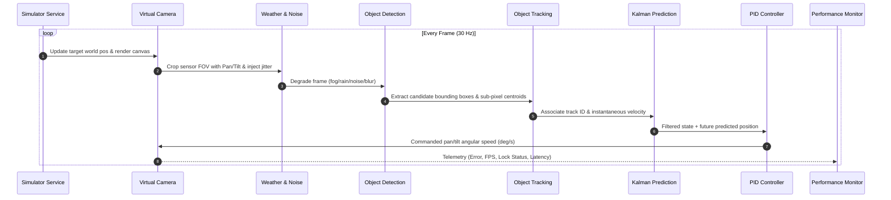

# System Architecture: FSOC Coarse Alignment Tracking System

This document describes the software architecture, design patterns, microservices decomposition, and communication protocols for the AI-Based Virtual Camera Tracking System.

---

## 1. Clean Architecture & SOLID Principles

The system is engineered according to **Clean Architecture** principles, enforcing strict separation of concerns across independent modules:

- **Single Responsibility Principle (SRP)**: Each tool in `tools/` performs one distinct task (e.g., `simulator` handles physics kinematics, `virtual_camera` handles optical projection, `object_detection` handles beacon detection, `kalman_prediction` handles state estimation).
- **Open/Closed Principle (OCP)**: Perception algorithms implement `IDetectorStrategy`, allowing new deep learning models (YOLOv11, RT-DETR, or classical moments) to be added without modifying the core detection pipeline.
- **Liskov Substitution Principle (LSP)**: All detector strategies (`AdaptiveSpotDetector`, `YOLOv11Detector`, `HybridDetector`) can be interchanged transparently at runtime.
- **Interface Segregation Principle (ISP)**: REST APIs expose focused endpoint subsets (`/step`, `/state`, `/config`), avoiding bloated monolith interfaces.
- **Dependency Inversion Principle (DIP)**: Controllers and high-level orchestrators depend on abstract interfaces rather than concrete hardware drivers.

---

## 2. Microservices Decomposition

The system is decomposed into 14 modular microservices, each packaged with its own `config.py`, `service.py`, `api.py`, `utils.py`, `main.py`, unit test suite, and `Dockerfile`:

```
tools/
├── configuration/       [Port 8001] Central configuration store & profile manager
├── logging/             [Port 8002] Structured JSON Lines event & telemetry logger
├── simulator/           [Port 8003] 2048x2048 optical canvas & multi-target kinematics
├── virtual_camera/      [Port 8004] PTZ gimbal camera, jitter, platform motion, MJPEG stream
├── weather_engine/      [Port 8005] Atmospheric attenuation (fog, rain, snow, haze, low light)
├── noise_generator/     [Port 8006] Sensor readout noise, Poisson shot noise, blurs
├── object_detection/    [Port 8007] YOLOv11 & sub-pixel moment centroiding
├── object_tracking/     [Port 8008] ByteTrack multi-target two-stage association
├── kalman_prediction/   [Port 8009] Constant acceleration Kalman filter & occlusion coasting
├── pid_controller/      [Port 8010] Dual-axis anti-windup gimbal servo controller
├── dataset_generator/   [Port 8011] Automated synthetic YOLO, COCO, and MOT dataset exporter
├── performance_monitor/ [Port 8012] Real-time KPI monitor & ISRO compliance evaluator
├── analytics/           [Port 8013] Matplotlib diagnostic charts & ReportLab PDF generator
├── replay_system/       [Port 8014] Replay controller & Benchmark-2 video file evaluator
└── utilities/           Shared geometry, image codecs, and HUD overlay rendering
```

---

## 3. Dataflow & Closed-Loop Control Sequence



---

## 4. Containerization & Orchestration

All 14 tools are defined in a unified `docker-compose.yml`. Each microservice can be built and scaled independently:
```bash
docker compose up --build
```
Shared volume mounts provide persistent storage for:
- `models/`: Neural network weights and ONNX models.
- `datasets/`: Synthetic training and evaluation datasets.
- `outputs/`: Telemetry logs, exported MP4 videos, PDF evaluation reports, and HTML dashboards.
